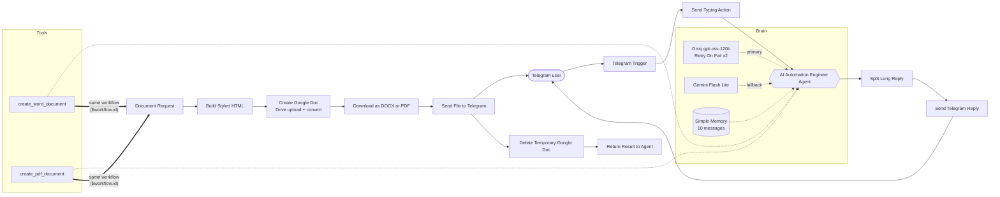

# AI Automation Engineer Bot for Telegram (n8n)

> A Telegram AI assistant built in n8n that helps design, build and debug automations, keeps working when its primary LLM hits a rate limit, and generates styled **Word (.docx)** and **PDF** files on request.


---

## Highlights

| Feature | What it does | Why it matters |
|---|---|---|
| **AI automation expert** | Answers questions about n8n, Make, Zapier, APIs, webhooks, RAG and AI agents, with strict "don't make things up" rules | Useful, honest answers instead of confident guesses |
| **Model fallback** | Groq (`gpt-oss-120b`) is the primary model; Google Gemini takes over automatically if Groq fails | The bot keeps replying when a free-tier model is rate-limited |
| **Retry on fail** | The primary model retries once after 3 seconds before falling back | Rides out short per-minute rate limits without switching models |
| **Word & PDF generator** | The agent writes a document and the bot sends back a styled `.docx` or `.pdf` | Turns chat answers into deliverables: SOPs, CVs, proposals, reports |
| **Conversation memory** | Remembers the last 10 messages per chat | Natural follow-up questions |
| **Telegram-safe replies** | Strips Markdown, splits long answers, escapes HTML | No broken or rejected messages |
| **One-canvas design** | The document pipeline lives in the same workflow as the bot | Easy to import, read and maintain |

## Demo

| Chat | Generated document |
|---|---|
|  |  |

> Add your own screenshots to `assets/screenshots/` (see the README in that folder).

## Architecture



More detail: [docs/architecture.md](docs/architecture.md)

## Quick start

1. **Import** `workflow/ai-automation-engineer-bot.json` into n8n (*Workflows → Import from File*).
2. **Create credentials** and select them in the nodes:

   | Credential | Used by | Where to get it |
   |---|---|---|
   | Telegram API | Telegram Trigger, Send Typing Action, Send Telegram Reply, Send File to Telegram | [@BotFather](https://t.me/BotFather) |
   | Groq | Groq Chat Model | [console.groq.com](https://console.groq.com) |
   | Google Gemini (PaLM) API | Gemini Fallback Model | [aistudio.google.com](https://aistudio.google.com) |
   | Google Drive OAuth2 | Create Google Doc, Download as DOCX or PDF, Delete Temporary Google Doc | Google Cloud Console (enable **Google Drive API**) |

3. **Activate** the workflow and message your bot.

Full walkthrough: [docs/setup-guide.md](docs/setup-guide.md)

## Feature deep dives

- [Model fallback and Retry On Fail](docs/features/model-fallback-and-retry.md): how the bot survives rate limits
- [Word and PDF generation](docs/features/word-and-pdf-generation.md): how chat text becomes a styled document
- [Document markup reference](docs/document-markup.md): the syntax the agent writes, and how to restyle documents
- [Troubleshooting](docs/troubleshooting.md)

## Example prompts

```text
How do I retry a failed HTTP Request node in n8n?
Design a workflow that saves Gmail attachments to Google Drive and notifies Slack.
Create a Word SOP for onboarding new clients.
Make a one-page project proposal as a PDF.
Turn this into a CV in Word: <paste your experience>
```

More: [examples/sample-prompts.md](examples/sample-prompts.md)

## Tech stack

- **n8n**: AI Agent node (with *Enable Fallback Model*), Call n8n Workflow Tool, Execute Workflow Trigger, Code, HTTP Request, Google Drive, Telegram
- **LLMs**: Groq `openai/gpt-oss-120b` (primary), Google `gemini-3.5-flash-lite` (fallback)
- **Google Drive API**: HTML-to-Google-Doc conversion and DOCX/PDF export
- **Telegram Bot API**

## Repository structure

```text
.
├── README.md
├── LICENSE
├── CHANGELOG.md
├── workflow/
│   └── ai-automation-engineer-bot.json   # import this into n8n
├── docs/
│   ├── setup-guide.md
│   ├── architecture.md
│   ├── document-markup.md
│   ├── troubleshooting.md
│   └── features/
│       ├── model-fallback-and-retry.md
│       └── word-and-pdf-generation.md
├── examples/
│   ├── sample-prompts.md
│   └── sample-document.md
└── assets/
    └── screenshots/
```

## Security notes

- The exported workflow contains **no credentials, tokens, chat IDs or personal data**. You attach your own credentials after import.
- Never commit API keys or bot tokens. If a token leaks, revoke it immediately (for Telegram: @BotFather → `/revoke`).
- Generated documents are created in your own Google Drive and deleted right after they are sent.

## Roadmap ideas

- Restrict the bot to an allow-list of Telegram user IDs
- Persistent memory (Postgres) instead of in-memory chat history
- More document themes selectable from chat
- Voice message input (Whisper transcription)

## License

[MIT](LICENSE)

## Author

**Eko Sarwono**: Mechanical Engineer turned AI Automation Engineer, building practical automations with n8n and AI agents.
