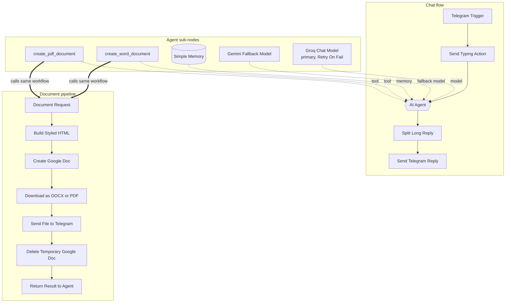

# Architecture

The whole bot is a single n8n workflow with two entry points:

1. **Telegram Trigger**: the chat flow, runs on every incoming message.
2. **Document Request** (Execute Workflow Trigger): the document pipeline, runs only when the agent calls a document tool.

## Node reference

### Chat flow

| Node | Type | Purpose |
|---|---|---|
| Telegram Trigger | Telegram Trigger | Receives messages (`message` updates) |
| Send Typing Action | Telegram | Shows "typing…" while the agent works |
| AI Automation Engineer Agent | AI Agent v3.1 | Reasons, calls tools, writes the reply. *Enable Fallback Model* is on |
| Split Long Reply | Code | Removes Markdown symbols and splits replies into 2,500-character chunks |
| Send Telegram Reply | Telegram | Sends each chunk with HTML parse mode and escaped text |

### Agent sub-nodes

| Node | Purpose |
|---|---|
| Groq Chat Model | Primary LLM (`openai/gpt-oss-120b`, temperature 0.3), Retry On Fail: 2 tries, 3 s |
| Gemini Fallback Model | Fallback LLM (`gemini-3.5-flash-lite`), used automatically when the primary fails |
| Simple Memory | Window memory of 10 messages, keyed by Telegram chat ID |
| create_word_document | Tool → this workflow, `format = docx` |
| create_pdf_document | Tool → this workflow, `format = pdf` |

### Document pipeline

| Node | Type | Purpose |
|---|---|---|
| Document Request | Execute Workflow Trigger | Inputs: `title`, `content`, `chat_id`, `format` |
| Build Styled HTML | Code | Markup → HTML with inline CSS → multipart upload body |
| Create Google Doc | HTTP Request | Drive multipart upload that converts HTML into a Google Doc |
| Download as DOCX or PDF | Google Drive | Exports the Google Doc in the requested format |
| Send File to Telegram | Telegram | `sendDocument` to the user's chat |
| Delete Temporary Google Doc | Google Drive | Permanent delete (continues on error) |
| Return Result to Agent | Set | One-line status the agent turns into a short confirmation |

## Design decisions

**One workflow instead of a separate sub-workflow.** The tools call `{{ $workflow.id }}`, so the document pipeline lives on the same canvas. It is easier to import, there is only one thing to activate, and recent n8n versions require called sub-workflows to be active anyway.

**Agent decides, workflow executes.** The LLM only decides *whether* to create a document and *what* to write. Formatting, file conversion and delivery are deterministic n8n nodes, which keeps documents consistent and cheap (no extra LLM calls).

**Tool returns a status, not the file.** Tool results go back to the agent as text. The file is sent to Telegram inside the pipeline itself, and the agent only receives "Success: … sent", so it does not paste the document into the chat.

**Plain-text chat replies.** Telegram does not render Markdown from LLMs reliably. The system prompt asks for plain text, *Split Long Reply* strips leftover symbols, and *Send Telegram Reply* escapes `& < >` in HTML parse mode. Underscores in file names or URLs then never break a message.

## Data flow and privacy

- Conversation memory is kept in n8n's in-memory window (lost on restart).
- Documents are created in the connected Google Drive and deleted right after sending.
- No data is stored outside Telegram, the LLM providers and the temporary Google Doc.
