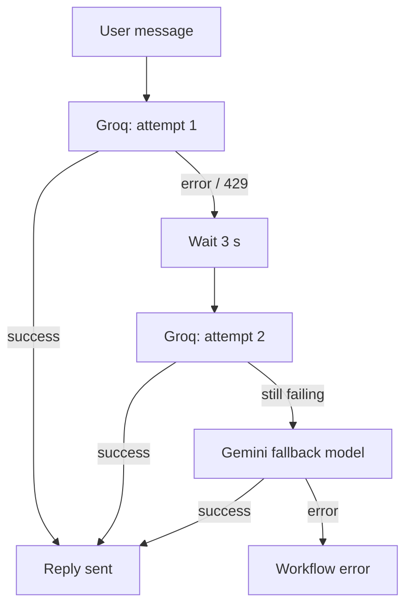

# Model Fallback and Retry On Fail

Free and low-cost LLM tiers are great for side projects, but they come with **rate limits**: requests per minute, tokens per minute, or a daily quota. When a limit is hit, the API answers with an error (usually HTTP 429) and a basic bot simply goes silent.

This workflow uses two layers of protection so the bot keeps answering.

## Layer 1: Retry On Fail (same model, short wait)

**Where:** Groq Chat Model → *Settings*

| Setting | Value | Meaning |
|---|---|---|
| Retry On Fail | on | Try the call again when it errors |
| Max Tries | 2 | One original attempt plus one retry |
| Wait Between Tries | 3000 ms | Pause before retrying |

**Why:** many limits are per minute. A short pause is often enough for the quota window to free up, so the conversation stays on the primary model and keeps a consistent tone.

**Trade-off:** each retry adds latency. Keep the number of tries low on chat bots, since users will not wait 30 seconds for a reply.

## Layer 2: Fallback model (different model, automatic)

**Where:** AI Automation Engineer Agent → **Enable Fallback Model** (the agent shows a second *Model* input), connected to **Gemini Fallback Model**.

**How it works:** when the primary model fails, the AI Agent node re-runs the same step with the fallback model. Everything else stays the same:

- the same system prompt
- the same tools (Word / PDF)
- the same conversation memory

The user just gets an answer. At most, the wording style changes slightly.

### Choosing a good fallback

- **Use a different provider.** Rate limits and outages are usually per provider. Groq + Google means one provider's bad day does not take down both.
- **Match capabilities.** The fallback must support **tool calling**, or the Word/PDF tools will not work when it takes over.
- **Fast and cheap is fine.** The fallback only runs occasionally; a "flash" or "mini" model is usually enough.

## Why not just pick one stronger model?

| Approach | Cost | Reliability | Notes |
|---|---|---|---|
| Single free model | Free | Breaks on rate limits | The bot goes silent |
| Single paid model | Paid | High | Simplest if you have a budget |
| **Free primary + free fallback + retry** | **Free** | **High for small/medium traffic** | What this template uses |

## Testing the fallback

1. Temporarily change the Groq model name to something invalid (for example `does-not-exist`).
2. Send the bot a message. It should still reply, now via Gemini.
3. Open the execution in n8n: the Groq node shows an error and the Gemini node shows a successful call.
4. Restore the correct model name.

## Going further

- For more than two models, chain agents: set the agent's *On Error* to *Continue (using error output)* and route the error branch to a second agent with another model, sharing the same memory session key.
- For production traffic, add an **error workflow** that alerts you when both models fail.
