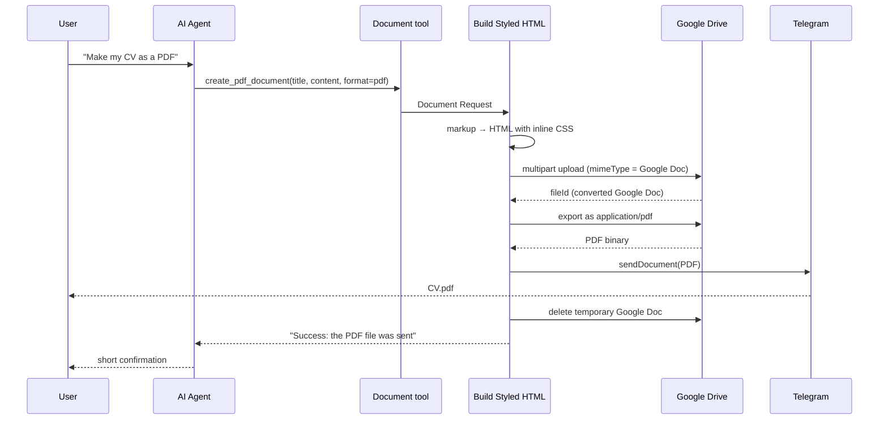

# Word and PDF Generation

Ask the bot for a document ("Create a Word SOP for client onboarding", "Make my CV as a PDF") and it sends back a styled `.docx` or `.pdf` file in the chat.

## The challenge

n8n has no built-in "create Word file" node, and the Google Docs API's text insertion creates plain, unstyled text. Third-party conversion APIs add cost and another credential.

## The approach: HTML → Google Doc → DOCX/PDF

Google Drive can **convert an uploaded HTML file into a Google Doc** and keep most of its styling (headings, bold, colors, lists, tables). Drive can then **export** that Google Doc as DOCX or PDF. Everything runs on the single Google Drive OAuth2 credential.



## Step by step

### 1. The agent writes lightweight markup

LLMs are very good at Markdown-like text, so the agent writes content such as:

```text
# Jane Doe
> Senior Mechanical Engineer & AI Automation Engineer
@ Jakarta | jane@example.com | linkedin.com/in/janedoe

## Experience
### Senior Mechanical Engineer || Jan 2015 - Present
> Example Energy Co.
- Led a team of 10 engineers
```

The full syntax is in [document-markup.md](../document-markup.md).

### 2. Two tools, one pipeline

| Tool | `format` | Output |
|---|---|---|
| `create_word_document` | `docx` | Editable Word file |
| `create_pdf_document` | `pdf` | Final, read-only PDF |

Both are *Call n8n Workflow* tools pointing to **this same workflow** (`{{ $workflow.id }}`), entering through the **Document Request** trigger. One pipeline, two outputs.

### 3. Build Styled HTML (Code node)

A small parser turns the markup into HTML with **inline CSS**, because Google Docs ignores most `<style>` blocks:

- `#` → title in large accent color, then a header block for `>` subtitle and `@` info lines, then a divider
- `##` → uppercase section heading + divider
- `### Left || Right` → a borderless two-column table (bold title left, italic date right), since flexbox does not survive conversion
- Numbered items followed by bullets → **nested lists**, so numbering stays 1, 2, 3
- `| a | b |` tables → bordered tables with a tinted header row
- `**bold**`, `_italic_`

It then builds a `multipart/related` body: JSON metadata (`name`, `mimeType: application/vnd.google-apps.document`) plus the HTML.

### 4. Create Google Doc (HTTP Request)

`POST https://www.googleapis.com/upload/drive/v3/files?uploadType=multipart` with the Google Drive OAuth2 credential. Setting the target `mimeType` to Google Doc makes Drive convert the HTML on upload.

### 5. Download as DOCX or PDF (Google Drive node)

The download operation uses **Google File Conversion** with an expression:

```js
{{ $('Document Request').item.json.format === 'pdf'
   ? 'application/pdf'
   : 'application/vnd.openxmlformats-officedocument.wordprocessingml.document' }}
```

### 6. Deliver and clean up

- **Send File to Telegram** sends the binary with a caption (HTML-escaped).
- **Delete Temporary Google Doc** removes the intermediate file permanently. It is set to *continue on error*, so a cleanup hiccup never blocks delivery.
- **Return Result to Agent** returns a one-line status, so the agent confirms briefly instead of pasting the whole document into chat.

## Lessons learned (Google Docs HTML import quirks)

| Problem | Fix used |
|---|---|
| `border-bottom` on a heading leaked onto the next paragraph or bullet | Use a real `<hr>` followed by a tiny spacer paragraph |
| Paragraph right after a divider inherited bold heading style | Spacer paragraph + explicit `font-weight:normal` |
| Numbering restarted at 1 when bullets sat between numbered items | Treat those bullets as nested sub-lists |
| Extra indent from CSS margins on list items (Docs already indents lists) | No extra margins on `<li>` |
| Flexbox and CSS grid ignored | Borderless tables for left/right layouts |
| Fonts not available in Google Docs get replaced | Use common fonts (Times New Roman, Arial, Calibri) |

## Customizing the look

Edit the **Theme** block at the top of **Build Styled HTML**:

```js
const C = { accent: '#1F3864', dark: '#1e293b', text: '#334155', ... };
const F = 'font-family:Times New Roman,Times,serif;';
```

Change the accent color, font family or sizes and every future document follows.

## Limitations

- Styling is close to, but not pixel-identical with, hand-made Word templates (Google Docs decides final spacing).
- Page margins use Google Docs defaults.
- Images are not supported in this version.
